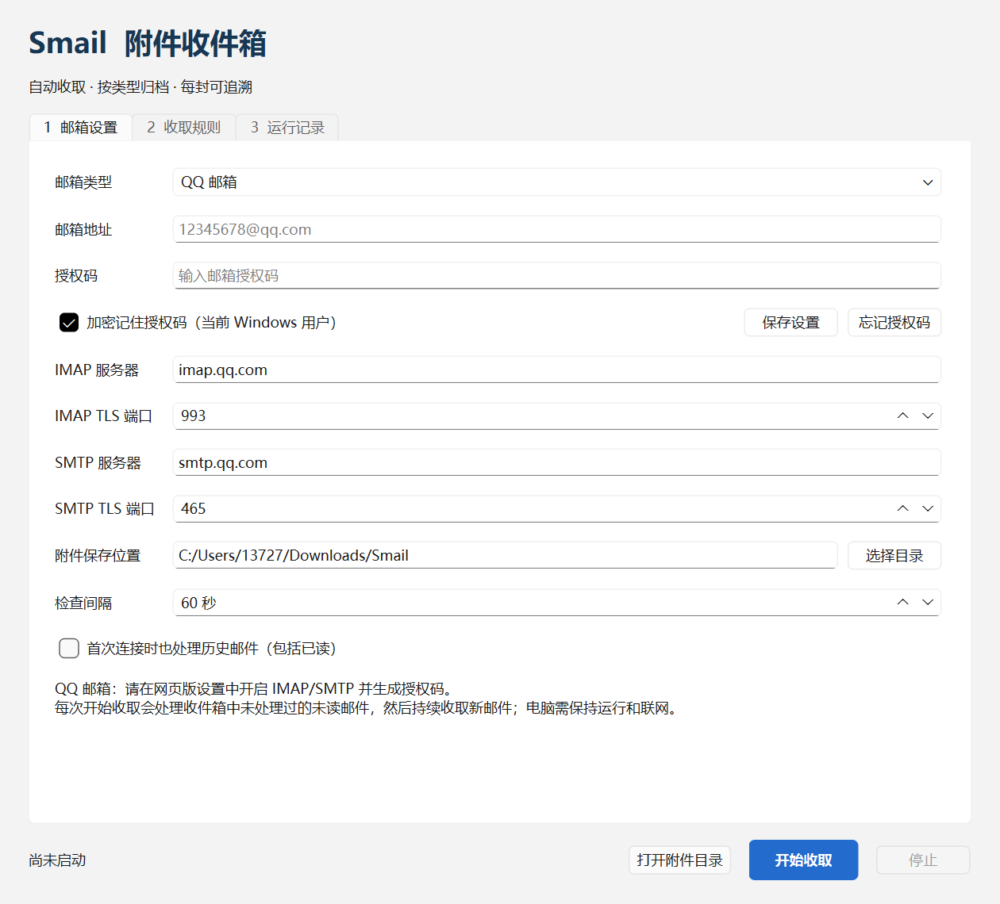
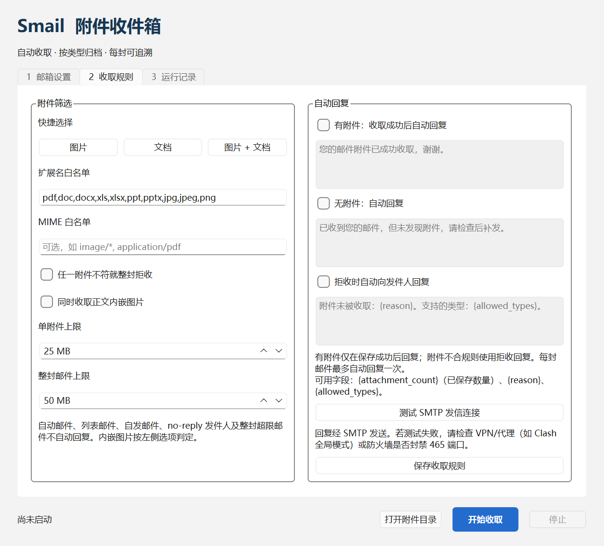

# Smail · 邮件附件自动收取

Qt 6 Widgets / C++17 桌面程序，采用 `src + include + CMake` 架构。
QQ 邮箱预设及自定义 IMAP/SMTP 服务器。



## 运行

安装版：`dist/Smail-0.1.4-windows-x64-setup.exe`（Windows 10/11 x64）。
当前版本 **0.1.4**，便携版位于 `dist/Smail/Smail.exe`。
默认安装到当前用户，包含 Qt 运行库、桌面/开始菜单快捷方式和卸载入口。
更新前请从托盘退出旧程序。卸载保留已下载附件、配置和授权码。
安装包尚未代码签名，可能显示“未知发布者”。

重新打包：安装 NSIS 后执行 `packaging/windows/build-installer.ps1 -NsisCompiler <makensis.exe路径>`；
可用 `-QtRoot`、`-CompilerBin` 指定开发环境。附带 SHA256 校验文件。
`-SmokeIdentity` 生成使用独立产品标识的测试包，随后运行 `test-installer.ps1`
验证安装、快捷方式、独立运行和卸载，不影响正式安装。

本工作区已生成 Windows x64 发布目录：`dist/Smail/Smail.exe`。
双击启动，移动程序时请复制整个 `dist/Smail` 文件夹，不能只复制 exe。

1. QQ 网页邮箱中开启 IMAP/SMTP 服务，生成授权码。
2. 输入邮箱地址、**授权码（不是网页登录密码）**、附件保存目录。
   默认勾选“加密记住授权码”，点击“保存设置”或“开始收取”后保存，重启后自动填入。
3. 在“收取规则”选择图片/文档，或自行输入扩展名白名单。
4. 根据需要开启自动拒收回复，修改回复正文。
5. 点击“开始收取”，程序先处理收件箱中尚未处理的未读邮件，再持续检查新邮件。

QQ 预设为 `imap.qq.com:993` / `smtp.qq.com:465`，均使用隐式 TLS。
自定义邮箱需支持 IMAP LOGIN 和 SMTP AUTH LOGIN；不支持 OAuth2、STARTTLS、
POP3、Exchange 专用协议或网盘附件链接。服务器设置以邮箱服务商说明为准。

程序默认每 60 秒检查；窗口关闭后保留系统托盘，右键托盘选择“退出”彻底关闭。
若系统没有托盘，关闭窗口即退出。电脑必须运行、联网且不休眠。

## 0.1.4 启动未读补查

- 每次点击“开始收取”都会补查收件箱未读邮件，包括旧版本建立基线前已收到的未读邮件。
- 按当前规则下载附件，并使用有附件／无附件／拒收对应的回复设置；开关需提前启用。
- 补查队列持久化，断线或停止后可恢复；补查旧邮件不会倒退新邮件进度。
- 已有处理记录不重复下载或回复，手动重新标为未读也不会触发重发。
- 启动程序后仍需点击“开始收取”；不自动连接邮箱。不扫描其他邮件文件夹。

## 0.1.3 回复修复

- 修复发件人显示名称本身是邮箱地址时（例如
  `"someone@example.com" <someone@example.com>`）被误判为多个发件人，
  导致有附件/无附件自动回复被静默跳过。现在只取尖括号内的唯一地址。
- 处理记录和运行日志会追加“未回复：原因”，例如开关未启用、自动/列表邮件、
  自发邮件、no-reply 发件人或找不到唯一发件人地址。
- 新增“测试 SMTP 发信连接”按钮和 `smail_smtp_probe.exe`：只连接并登录，
  不发送邮件，用于区分授权码问题与网络/代理封禁 SMTP 端口。
- SMTP 发送结果仍持久化为 `attempted/sent/uncertain`；`uncertain` 不自动重发，
  避免重复回信。修复网络后请重新发送一封测试邮件。

## 收取规则与通知

- 扩展名不区分大小写，可输入 `pdf,docx,jpg`；留空允许所有扩展名。
- 可叠加 MIME 白名单，如 `image/*,application/pdf`；两种规则同时配置时需同时满足。
- 默认仅保存匹配部分；开启严格模式后，任一附件不符即整封拒收。
- 默认忽略正文内嵌图片；可开启。默认单附件 25 MB、整封邮件 50 MB。
- 拒收指不保存附件，可自动回复；不删除邮件，不是服务器投递退信。
- “收取规则 → 自动回复”中可分别开启“有附件：收取成功后自动回复”和“无附件：自动回复”，
  为两种状态填写不同的多行文字，点击“保存收取规则”保存。新开关默认关闭，旧设置保持兼容。
- 有附件回复仅在匹配附件全部保存成功后发送；没有附件使用无附件文字；附件不合规则只使用拒收回复。
  三种情况互斥，每封最多回复一次；即使拒收回复关闭，也不会误发收取成功或无附件回复。
- 模板支持 `{reason}`、`{allowed_types}`（扩展名列表）、`{attachment_count}`（实际保存数量）。
- 超大邮件、自动邮件、列表邮件、自发邮件与 no-reply 发件人不自动回复。
  未启用内嵌图片收取时，只有内嵌图片的邮件视为无附件；历史记录展示“有附件/无附件”。
- 保存成功、拒收或无附件处理完成后标记已读，并写入运行记录及日志，弹出托盘通知。
  通知是否可见取决于 Windows 通知设置；历史记录始终可查。



## 稳定性与数据

0.1.1 修复了 TLS 建连被 250 ms 短超时过早中止的问题，使用 30 秒总超时并
记录详细失败阶段。调查及验证边界见 [TLS 故障检查](docs/tls-investigation.md)。

首次连接默认跳过旧的已读邮件，未读邮件自动补查；“收取历史邮件”可额外处理已读历史邮件，仅对尚未建立基线的邮箱有效。
按 UID 跟踪新邮件，因此在手机上读过的新邮件也会收取。服务端 UIDVALIDITY
变化时重建基线，采用当前历史收取选项。

筛选后只有一个附件时，直接以原文件名保存到指定目录，不创建邮件子目录；
同名文件自动编号，如 `报告 (2).pdf`。多个附件仍使用消息目录 + 编号存储。
SQLite 在写入单附件前预留文件名，重试复用原路径；已有历史文件保持原位置。
附件使用原子写入；SQLite 保存处理进度，
断线后退避重试（最多 15 分钟），标记已读失败时从已有结果恢复。
同账号失败邮件会阻塞后续进度，避免静默丢失；无法解析的邮件可先手动移出收件箱，
核查日志后等待下轮处理。首版不提供 UI 跳过功能。

配置、SQLite 历史和轮转日志默认位于
`%LOCALAPPDATA%/Smail/Smail/`。Windows 下授权码通过当前用户范围的 DPAPI 加密，
密文保存在该目录的 `credentials/*.dpapi`，不写入 JSON 配置或日志，也不在程序中内置密钥。
凭据按邮箱及 IMAP/SMTP 服务器、端口隔离，切换连接设置会清空旧输入并查找对应凭据。
应用不设置凭据过期时间；邮箱服务商撤销或更换授权码后，需要重新输入并保存。
点击“忘记授权码”可删除当前连接配置的密文；取消勾选后点击“保存设置”或“开始收取”
也会删除该密文，仅在本次运行中使用。其他平台暂不持久保存授权码。
加密绑定 Windows 用户，通常也绑定当前电脑，换电脑或重装系统后应重新输入；
无法防止同一已登录用户下的恶意程序读取运行中的授权码。
不要删除状态数据库，否则会重建收取基线。
日志和历史含邮件主题、路径等本地业务信息。

SMTP 与 SQLite 无法组成原子事务：回复发送前记录 `attempted`，
确认发送为 `sent`，异常为 `uncertain`。`attempted`/`uncertain`
不自动重发，需人工核查；极端中断时可能漏发回复。托盘通知不保证崩溃后的重放。

若“测试 SMTP 发信连接”在 TLS 握手阶段报 `Remote host closed`，通常不是授权码错误，
而是校园网、防火墙、VPN 或代理封禁了 SMTP 的 465/587/25 端口（IMAP 993 往往仍可用）。
例如 Clash Verge 处于“全局/Global”模式时，所有连接都走代理节点，而不少节点拒绝 SMTP；
请切换到“规则/Rule”或“直连/Direct”模式，添加 `DOMAIN-SUFFIX,qq.com,DIRECT`
（或 `DOMAIN,smtp.qq.com,DIRECT`），或暂时退出代理/改用手机热点后再测试。
SMTP 测试失败时不会发送邮件，也不会修改现有处理记录。
文件类型检查基于邮件扩展名和 MIME 声明，不是内容鉴真或杀毒。

## 构建与验证

依赖：CMake ≥ 3.21、C++17 编译器、Qt ≥ 6.5 的 Core、Widgets、Network、Sql、Test。
使用与 Qt 安装包匹配的编译器。以下为本机 PowerShell 命令：

```powershell
$env:PATH = "D:\Application\QtTools\Tools\mingw1310_64\bin;D:\Application\QtTools\6.11.2\mingw_64\bin;" + $env:PATH
cmake -S . -B build -G Ninja `
  -DCMAKE_PREFIX_PATH=D:/Application/QtTools/6.11.2/mingw_64 `
  -DCMAKE_CXX_COMPILER=D:/Application/QtTools/Tools/mingw1310_64/bin/g++.exe `
  -DCMAKE_BUILD_TYPE=Release
cmake --build build -j 4
ctest --test-dir build --output-on-failure
```

其他环境替换 Qt 路径与匹配编译器即可。Windows 发布：

```powershell
New-Item -ItemType Directory -Force dist/Smail
Copy-Item build/Smail.exe dist/Smail/
windeployqt --release --no-translations dist/Smail/Smail.exe
```

离线界面/TLS 后端启动检查，不连接邮箱、不发信：

```powershell
.\dist\Smail\Smail.exe --data-dir .\build\smoke-state --smoke-test
```

`--screenshot <PNG路径>` 可以生成三个页签截图并退出；`--data-dir` 可隔离测试数据。
程序不带自动连接功能，正常启动也必须主动点击开始才连接。

本机已完成：Release 编译、15 项核心业务测试、4 项 Schannel TLS 回归测试
（另有 init/cleanup，包含 DPAPI 往返、篡改拒绝与凭据隔离）、2 项本地 SMTP
发信/登录回归测试、打包程序启动/TLS 后端检查、三个页签截图检查。
**尚未用真实邮箱完成“自动回复到达收件人”的端到端验证，也未验证所有服务商及 MIME 变种。**

只检查发信连接（不发送邮件，读取同一数据目录中已保存的授权码）：

```powershell
.\build\smail_smtp_probe.exe
# 或指定数据目录
.\build\smail_smtp_probe.exe --data-dir "$env:LOCALAPPDATA\Smail\Smail"
```

真实邮箱建议验收：PDF、PNG、EXE、不带附件、混合附件、超限附件各发一封；
检查目录、已读状态、通知、回复的“未回复原因”，以及发件人显示名称与邮箱相同的情况；
先点“测试 SMTP 发信连接”确认网络放行，再发送测试邮件；断网重连及程序重启后检查是否重复下载/回复。

## 架构与后续方向

见 [整体架构](docs/qt-architecture.md)。
推荐后续增加其他平台的系统凭据库、发件人白名单、
多账号与按项目归档；然后再加入 OAuth2、开机启动和杀毒扫描。
目前实现为独立桌面工具，若需嵌入其他宿主软件，可在 `smail_core` 之上增加插件适配层。

实现参考：[Qt QSslSocket 官方文档](https://doc.qt.io/qt-6/qsslsocket.html)。
加密参考：[Microsoft DPAPI 文档](https://learn.microsoft.com/en-us/windows/win32/api/dpapi/nf-dpapi-cryptprotectdata)。
